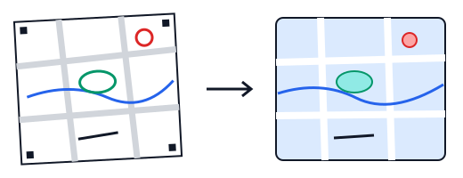

# From Paper to Map

**A mapping activity for ages 8 to 12**

Become a neighbourhood mapper. Draw what you know about your streets on a paper
map, then watch your drawing appear on a digital map of the world.

Taught by [Sonia Das](https://soniadas123.github.io/soniadas/), Geospatial
Specialist, Bengaluru.

{ width="520" }

## Overview

Children know their neighbourhood better than any map does: the shortcut behind
the shops, the park with the good swings, the corner that floods when it rains.
In this two-hour activity they walk around the neighbourhood, mark what they
find on a printed street map, and then see a computer turn their drawing into
real map data.

## Who is this for

- Children aged **8 to 12**
- No prior mapping or computer experience needed

## In two hours, your child will

1. **Spot** the parks, water, shops and shortcuts only locals know
2. **Draw** them on a printed street map with a colour-coded key
3. **Photograph** the map and see a computer turn it into real map data
4. **Compare** their drawing with satellite images of the same streets

**Tools they'll meet:** a free website that reads hand-drawn maps, and real
map-making software to see everyone's drawings on one map.

## Schedule

| | |
|---|---|
| **When** | Every Saturday, from 24 October 2026 |
| **Time** | 10 am to 12 noon (2 hours) |
| **Ages** | 8 to 12 |

!!! note "Please note"
    This activity involves walking around the neighbourhood and collecting
    data. Comfortable shoes and a water bottle are a good idea.

## How to register

Write to [sonia.geoai@gmail.com](mailto:sonia.geoai@gmail.com) to book a seat
or to know more.
