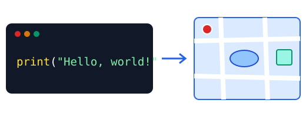

# Dive into Python

With a GIS Specialist. Learn to code by exploring maps and real data about the
world around you.

!!! info "Coming soon"
    This course is currently in development. Write to
    [sonia.geoai@gmail.com](mailto:sonia.geoai@gmail.com) to hear when it opens.

{ width="520" }

## Overview

Python is one of the most popular programming languages in the world, and it is
used every day to work with maps and data. In this course children write real
Python code from the very first session, and see their code turn into maps
they can explore.

## Who is this for

- Children aged **11 to 14**
- No coding experience needed

## In this course, your child will

1. **Write** their first lines of Python code
2. **Explore** real data about places they know
3. **Create** interactive maps they can zoom, click and share
4. **Build** a small mapping project of their own

Course developed by [Sonia Das](https://soniadas123.github.io/soniadas/)
and Shivangi Das.

## Register your interest

Write to [sonia.geoai@gmail.com](mailto:sonia.geoai@gmail.com).
